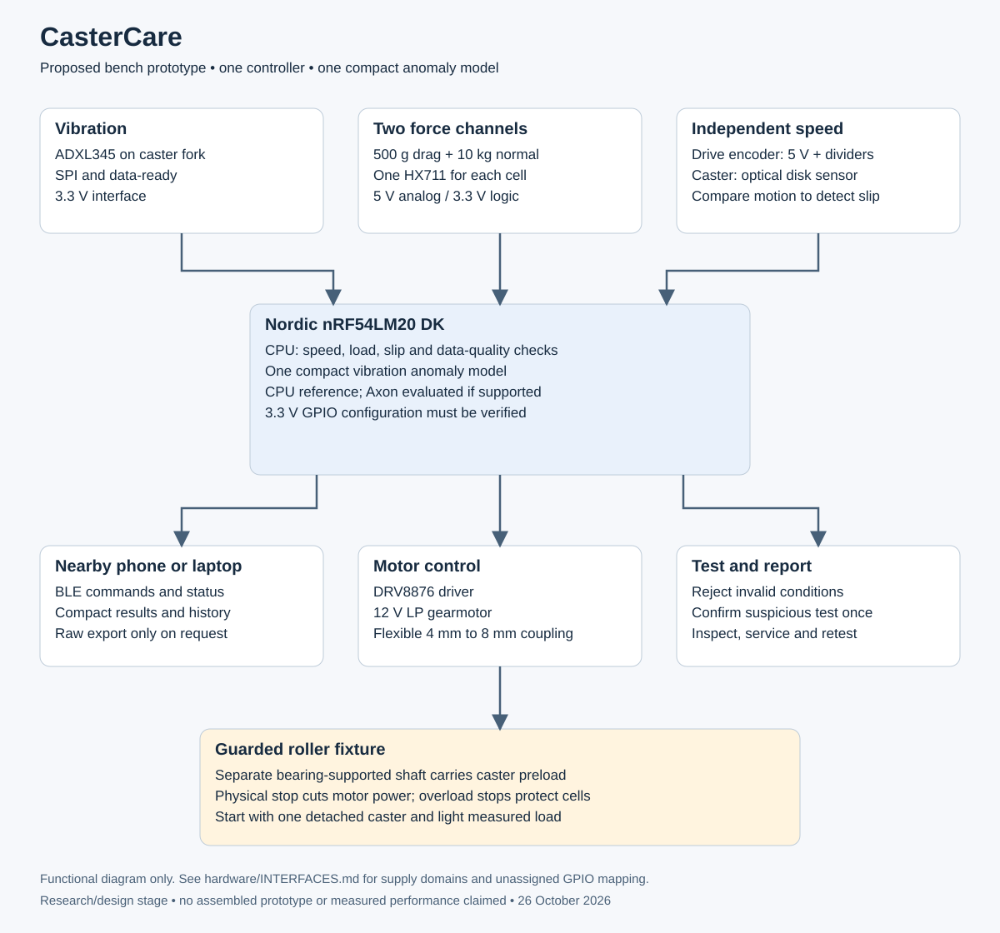

# CasterCare

**Context-aware Edge AI health checks for manual wheelchair casters.**

CasterCare is a proposed bench instrument that checks a detached wheelchair caster under repeatable conditions. It measures vibration, rolling drag, applied load and actual wheel speed. It rejects invalid tests, confirms suspicious results once, and records whether servicing improved the measurements.

**Status: project started at the research and design stage.** This repository contains the initial BOM, engineering rationale, diagrams and validation plan. No firmware, trained model, assembled prototype, performance result or clinical certification is claimed.

## Start here

- [The idea in simple English](docs/IDEA.md)
- [Initial bill of materials](hardware/BOM.md) — includes the **Nordic nRF54LM20 DK**
- [Machine-readable BOM](hardware/BOM.csv)
- [Architecture and operating sequence](docs/ARCHITECTURE.md)
- [System diagram](docs/diagrams/system.svg)
- [Electrical interfaces and voltage checks](hardware/INTERFACES.md)
- [Mechanical measurement concept](hardware/MECHANICAL.md)
- [Validation and build milestones](docs/VALIDATION.md)
- [Research and component sources](docs/RESEARCH.md)

## The problem

A caster can keep turning while becoming harder to roll or developing unusual vibration. A service technician needs to distinguish a changed wheel from a poor test setup, then check whether maintenance helped. CasterCare focuses on that practical inspection workflow rather than predicting an unsupported failure date.

Existing wheelchair maintenance systems, including WheelTrak research and Permobil remote diagnostics, already address related needs. CasterCare's proposed contribution is **controlled caster testing with operating-condition checks and repair verification**. See [research](docs/RESEARCH.md); novelty and commercial demand have not been established.

## What will be built

1. Secure one selected spare caster assembly in a guarded roller fixture.
2. Apply a light, measured load appropriate to a proof-of-concept test.
3. Drive the roller at a repeatable speed; measure caster rotation independently to detect slip.
4. Reject excessive slip, unstable speed, overload or invalid sensor readings.
5. Compare valid vibration features and drag measurements with an inspected healthy reference.
6. Repeat one suspicious test under the same conditions; show an inconclusive result if the runs disagree.
7. Inspect/service, retest and record the measured improvement or lack of improvement.

## Edge AI and Bluetooth

The nRF54LM20 DK is the only main controller. Programmed CPU checks validate operating conditions; one small anomaly model analyses vibration features. Training happens on a computer, with CPU inference first and an Axon-compatible deployment evaluated later. Force thresholds provide an independent comparison.

Bluetooth Low Energy carries test commands, status and compact results to a nearby application. Raw recordings are exported only on request during development. The board enforces local stop conditions; an app connection is not the sole means of stopping the roller. No second wireless node, Channel Sounding, cloud inference or continual neural-network training is required.

## Initial hardware choices

| Function | Reference selection |
|---|---|
| Controller and BLE | Nordic nRF54LM20 DK |
| Vibration | Adafruit ADXL345 breakout, product 1231, using SPI |
| Drive and roller speed | Pololu 4886, 12 V low-power 25D gearmotor with encoder |
| Motor control | Pololu 4036 DRV8876 carrier |
| Drag and normal force | 500 g TAL221 and 10 kg TAL220 cells, each with a separate SparkFun HX711 board |
| Independent caster rotation | Vishay TCST2103 and a removable guarded slotted disk |
| Fixture | Custom supported roller shaft, flexible coupling, caster carriage and overload stops |

The research found two important integration requirements: the DK's default GPIO supply is **1.8 V**, and the selected motor encoder requires at least **3.5 V**. The proposed setup configures the DK to **3.3 V**, powers the encoder at **5 V**, and reduces both encoder signals before they reach the DK. Read [interfaces](hardware/INTERFACES.md) before connecting hardware.

## Scope and evidence

- Start with a detached caster and a light bench preload, not a person sitting in a wheelchair.
- The BOM is an initial reference design, not a tested wiring schematic or a complete purchasing quote.
- Early degradation detection and maintenance verification are targets. Remaining useful life is not estimated.
- An ADXL345 is a modest proof-of-concept vibration sensor, not an ultrasonic bearing instrument.
- Motor/gearbox vibration can contaminate readings and must be tested explicitly.
- Prices shown are source observations, not promises of Indian stock or landed cost.

## Contest context

Prepared for [Sustain the System](https://www.hackster.io/contests/sustain-the-system). This repository is intended as the public project-start link and beginning BOM requested by the hardware application. It does not itself create a Hackster project, submit an application, or confirm organizer acceptance of a GitHub link.

**Research checked:** 26 October 2026. **Confidence:** high for cited component specifications; moderate for proposed mechanical integration; measurement performance remains unvalidated.
