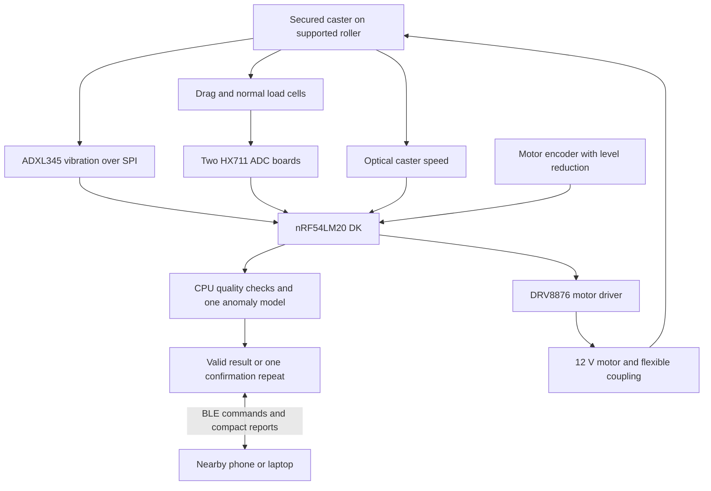
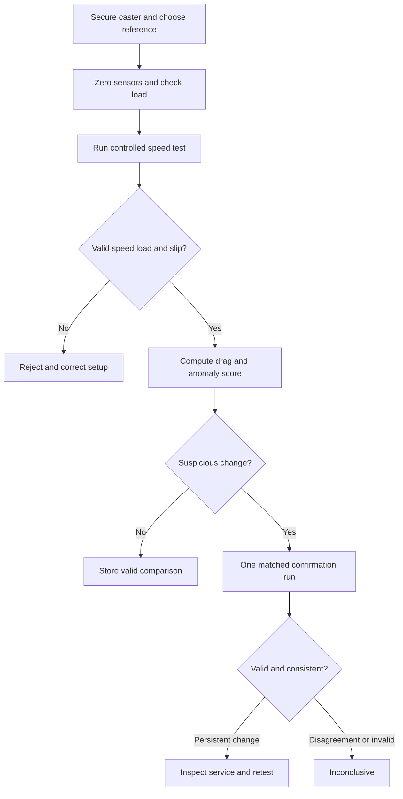

# Architecture

This is a proposed functional architecture, not a pin-level electrical schematic.

## Data and control paths

## Proposed operating sequence

The implementation must stop the motor on a hardware stop, missing sensor input, overload, stalled motion or communication timeout as appropriate. The stop button interrupts motor power as well as informing software. A person must not reach past the guard while motion is possible.

## Acquisition targets

These are starting design targets, not tested specifications:

| Input | Initial target | Use |
|---|---|---|
| Accelerometer | 800 samples/s over SPI, with data-ready or FIFO handling | Vibration features; move to 1600 only after verifying at least 2 MHz SPI and loss-free capture |
| Each HX711 | 10 samples/s initially; average a stable window | Mean drag and normal load, not bearing vibration |
| Motor encoder | Timestamp/counter capture | Roller speed feedback |
| Caster optical disk | 12 slots with one-edge pulse counting | Actual caster RPM and slip check |
| BLE | Periodic status, end-of-test report, raw export on request | Avoid continuous raw streaming in routine mode |

An example 40 mm roller at 60 RPM has a surface speed near 0.126 m/s. A 100 mm caster would rotate near 24 RPM without slip, producing about 4.8 pulses/s from a 12-slot disk. A 20 s measurement spans about eight caster turns. These are geometry calculations for an illustrative fixture, not a guaranteed motor operating point.

## Firmware and model plan

Use the Nordic-supported nRF Connect SDK/Zephyr workflow for the actual board revision. Record the tested SDK version before publishing any build instructions. No firmware is implemented in this repository yet.

1. Bring up each input independently and prove timestamps and units.
2. Implement a fixed speed test with local stop conditions.
3. Add programmed validity limits and save accepted/rejected recordings.
4. Implement feature extraction and a simple threshold reference.
5. Deploy one compact anomaly model and compare it fairly.
6. Evaluate the supported model on Axon if the tooling is practical.
7. Add the BLE client and result history.

Raw 20 s, three-axis, 16-bit data at 800 samples/s is about 96 kB before headers. Use a bounded buffer or incremental features, not an unbounded log. Store small references in nonvolatile memory; select a raw-export transport after measuring actual memory and throughput.

## Proposed BLE interface

| Characteristic | Direction | Payload intent |
|---|---|---|
| Command | Client to DK | Select profile, start, confirm, cancel, export |
| Status | DK to client | State, progress, validity flags, heartbeat |
| Result | DK to client | Test ID, reference version, load, speed, drag, score, outcome |

Assign project UUIDs during firmware implementation. Pair and authorize commands before exposing motor controls. A BLE command is a request; the DK independently validates the fixture and state. Browser Web Bluetooth availability is not assumed; a native BLE client or development application is acceptable initially.
